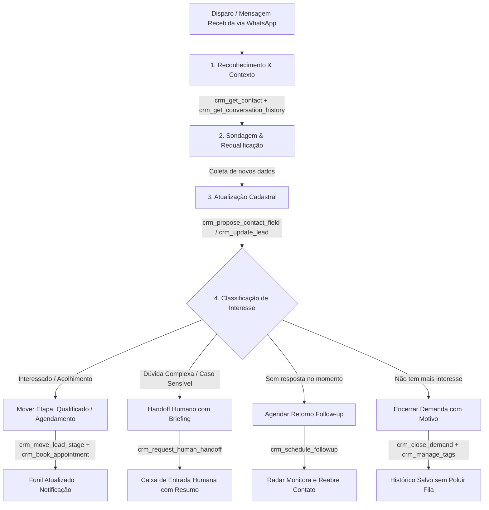

# 📋 Resumo Executivo: Capacidades do DeskcommCRM para o Funil de Requalificação (Esperança e Vida)

Este documento foi elaborado para alinhar com a gerência as capacidades operacionais e técnicas do **DeskcommCRM**, permitindo confrontar e mapear diretamente o **plano do funil de requalificação** com o **prompt** e as **tools (ferramentas)** do nosso Agente de IA.

---

## 🎯 1. Visão Geral do DeskcommCRM

O **DeskcommCRM** opera como um **Sistema Operacional de Vendas e Atendimento com IA** nativo para WhatsApp (com suporte tanto à **API Oficial Meta via Omnique Cloud API** quanto via **QR Code/WAHA**).

Diferente de um simples chatbot de disparo, o CRM expõe sua estrutura completa de dados e regras de negócio para os agentes de IA através do protocolo padronizado **MCP (*Model Context Protocol*) via `/api/mcp`**. Isso permite que o agente (seja nativo ou implementado via LangGraph) leia o histórico, tome decisões baseadas em regras de negócio, mova cards no funil e acione atendentes humanos de forma totalmente auditada.

---

## 🧰 2. Mapa de Capacidades por Jornada & Tools MCP

As ferramentas que o agente pode acionar estão agrupadas em **pacotes de negócio**, com classificação de risco (*Seguro*, *Atenção*, *Crítico*):

| Pacote | O que o Agente consegue fazer | Tools Principais (MCP) | Nível de Risco |
| :--- | :--- | :--- | :--- |
| **Atender & Identificar** | Localizar a ficha do contato, ler todo o histórico de conversas anteriores e responder no WhatsApp sem fazer o cliente repetir o que já disse. | `crm_search_contacts` `crm_get_contact` `crm_get_conversation_history` `crm_send_whatsapp_message` `crm_propose_contact_field` | **Seguro / Crítico** *(envio direto ao cliente)* |
| **Vender & Mover Funil** | Registrar novas oportunidades, atualizar dados colhidos na conversa e avançar ou retroceder o contato nas etapas do funil Kanban. | `crm_list_pipelines` `crm_list_stages` `crm_get_lead` `crm_create_lead` `crm_update_lead` `crm_move_lead_stage` | **Seguro / Atenção** |
| **Reter & Radar de Risco** | Evitar que contatos esfriem no silêncio. Agenda datas/horários de retorno, inscreve em réguas de acompanhamento e detecta quem está sem próximo passo. | `crm_schedule_followup` `crm_enroll_followup_flow` `crm_cancel_followup` `crm_list_followups` `crm_list_at_risk_leads` `crm_close_demand` `crm_propose_reactivation` | **Seguro / Atenção / Crítico** *(fechamento)* |
| **Escalar & Handoff Humano** | Chamar um atendente humano com motivo e resumo detalhado (`o_que_tentei`, `cliente_quer`), verificar quem está disponível na equipe e retomar o robô após atendimento humano. | `crm_request_human_handoff` `crm_list_available_attendants` `crm_list_human_cases` `crm_get_human_case` `crm_add_case_note` `crm_resume_ai_attendance` | **Atenção / Crítico** |
| **Agendar & Horários** | Consultar serviços oferecidos, checar horários livres na agenda da equipe e reservar/confirmar horários diretamente na conversa. | `crm_list_event_types` `crm_find_free_slots` `crm_book_appointment` `crm_confirm_appointment` `crm_reschedule_appointment` | **Seguro / Atenção** |
| **Conhecimento & RAG** | Consultar políticas institucionais, regras de acolhimento e dados institucionais oficiais sem alucinação. | `crm_search_knowledge` `crm_get_org_memory` | **Seguro** |
| **Organizar a Operação** | Aplicar marcadores/etiquetas na conversa/lead, consultar respostas prontas da instituição e monitorar filas. | `crm_manage_tags` `crm_list_tags` `crm_get_queue_status` `crm_render_message_template` | **Seguro / Atenção** |

---

## 🔄 3. Como o CRM Executa o Funil de Requalificação da Esperança e Vida

Abaixo está o cruzamento do fluxo prático de requalificação com as capacidades que o CRM entrega ao agente:

### 1. Reconhecimento e Contexto
* **No Funil:** O contato responde à mensagem inicial de requalificação.
* **No CRM:** O webhook oficial (Omnique) entrega a mensagem. O agente roda `crm_search_contacts` e `crm_get_conversation_history`, recuperando o histórico prévio da pessoa na Esperança e Vida para não tratá-la como um desconhecido.

### 2. Sondagem e Atualização Cadastral
* **No Funil:** O contato confirma ou altera dados (telefone alternativo, e-mail, cidade/bairro, situação atual).
* **No CRM:** O agente usa `crm_propose_contact_field` ou `crm_update_lead` para salvar os novos dados na ficha do cliente de forma auditada, além de aplicar tags temáticas com `crm_manage_tags` (ex.: `#recadastrado-2026`, `#perfil-ativo`).

### 3. Condução do Funil (Kanban do CRM)
* **No Funil:** Cada resposta representa um estágio: *Tentativa de Contato*, *Em Sondagem*, *Requalificado*, *Necessita Atendimento Humano*, *Desistente / Sem Interesse*.
* **No CRM:** O agente consulta as etapas com `crm_list_stages` e atualiza a coluna do card com `crm_move_lead_stage`. O gerente e a equipe visualizam a movimentação em tempo real no Kanban do CRM.

### 4. Agendamento ou Próximo Passo
* **No Funil:** O contato deseja agendar uma visita, sessão ou conversa com a equipe.
* **No CRM:** O agente chama `crm_find_free_slots` e `crm_book_appointment` (ou `crm_find_and_book_appointment`), garantindo reserva sem conflito com as agendas dos profissionais.

### 5. Escalação Humana Humanizada (Handoff)
* **No Funil:** Situações de alta sensibilidade, casos críticos ou quando o acolhido solicita expressamente falar com uma pessoa.
* **No CRM:** A tool `crm_request_human_handoff` pausa a IA e abre um chamado no Inbox com dois campos estruturados:
  * `o_que_tentei`: resumo do que a IA já apurou e perguntou.
  * `cliente_quer`: a demanda exata e sensibilidade do caso.
  * O atendente humano assume a conversa já sabendo o contexto completo, sem pedir para o acolhido repetir.

### 6. Proteção "Anti-Morte" (Evitar que o Lead Esfrie)
* **No Funil:** A pessoa disse que "está no trabalho e responde mais tarde" ou parou de responder no meio da requalificação.
* **No CRM:** O agente executa `crm_schedule_followup` para uma data/hora futura ou `crm_enroll_followup_flow`. Se o contato não responder, o **Radar de Risco** do CRM (`crm_list_at_risk_leads`) alerta a equipe para intervenção ativa.

---

## 🛠️ 4. Comparativo Direto: Prompt do Agente vs. Capacidades do CRM

Para que o gerente avalie se o **prompt** atual está cobrindo todas as possibilidades, utilize esta lista de conferência:

| Etapa do Prompt do Agente | Capacidade / Tool Correspondente no CRM | Verificação de Cobertura |
| :--- | :--- | :--- |
| **Instrução de Tom e Memória** | `crm_get_conversation_history` + `crm_get_org_memory` | O agente verifica conversas antigas antes de responder? |
| **Confirmação de Dados** | `crm_propose_contact_field` + `crm_manage_tags` | Os dados validados vão para o cadastro e recebem as tags corretas? |
| **Avanço de Qualificação** | `crm_move_lead_stage` | O prompt instrui claramente a qual estágio do funil mover em cada desfecho? |
| **Tentativa de Agendamento** | `crm_find_free_slots` + `crm_book_appointment` | O agente oferece apenas horários reais validados pela agenda? |
| **Situação Sensível / Pedido Humano** | `crm_request_human_handoff` | O prompt instrui a preencher o briefing com o que o cliente quer? |
| **Silêncio / Adiamento** | `crm_schedule_followup` | O prompt agenda o retorno em vez de apenas encerrar a conversa? |
| **Encerramento Definitivo** | `crm_close_demand` | O agente registra o motivo de perda/ganho para alimentar as métricas do CRM? |

---

## 💡 5. Pontos Fortes para Apresentar à Gerência

1. **Segurança e Isolamento:** Cada ação de escrita é auditada; tools de risco crítico exigem confirmação explícita ou gates no sistema.
2. **Sem Duplicidade de Trabalho:** Atendentes humanos e o Agente de IA operam na mesma tela (Inbox do CRM), sem sistemas paralelos ou planilhas soltas.
3. **Visibilidade Operacional em Tempo Real:** A gerência acompanha a evolução do funil diretamente pelo Kanban e pelas telas de métricas e relatórios do DeskcommCRM.
4. **Resiliência de Canal:** Compatível com a conexão oficial Omnique/Meta, garantindo entrega confiável de mensagens e templates fora da janela de 24 horas.
